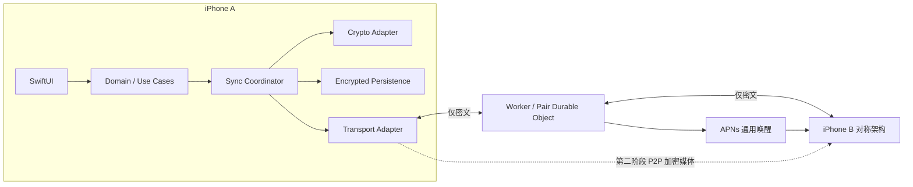

# Couple Private Space — 架构提案

> 范围更新（2026-09-12）：本文保留初始架构决策与历史阶段划分；当前范围已扩展到媒体、回忆、清单、轻互动和时间胶囊。功能与验收要求以 [当前产品规格](product-spec.md) 为准，本文“只预留接口”等旧阶段描述不再代表当前计划。

版本：0.1 · 2026-09-11 · 状态：设计提案，尚未实现或完成安全审计。

本提案覆盖第一阶段的配对、端到端加密文字聊天、愿望、接收端随机提醒、经期共享、临时密文邮箱、APNs、本地加密存储与同步。最低部署目标 iOS 18.0；在 iPhone 15 / iOS 18.3.2 与 iPhone 17 / iOS 26.1 真机验收。不依赖 iOS 26 专属能力。图片、语音、P2P、回忆和清单只预留接口。

## 1. 总体决策与保证边界

推荐 SwiftUI 原生客户端 + 加密 SQLite + 成熟会话加密库 + Cloudflare Worker / SQLite-backed Durable Object。一个部署只服务一个 pair，每人一个有效设备身份，共两个席位；不提供公开注册、多租户入口或第三设备。

两台设备分别保存自己的私有数据、共享数据副本和同步日志。服务器仅保存设备路由与有期限的密文。业务层不认识 Cloudflare、APNs 或 WebRTC。默认不开任何行为分析或云端历史备份。

必须区分以下承诺：

| 项目 | 本方案的承诺 |
|---|---|
| 端到端加密 | 内容上传之前加密；后端不持有内容解密密钥 |
| 送达 | 接收设备验证、解密、提交本地事务后，生成加密送达回执；发送端验证回执才显示已送达 |
| 愿望立即可见 | 接收设备成功持久化后立即进入应用数据查询结果；不是发送成功就保证远端立即可见 |
| 后台通信 | 尽力唤醒；前台启动/恢复必须主动拉取补偿，不能保证实时到达 |
| 24 小时 TTL | 单次邮箱驻留上限；过期不代表本地内容或发送任务消失 |
| 最终收敛 | 在设备仍保有数据、未来能运行且有成功通信机会的条件下成立 |
| 删除服务器数据 | API 和在线存储中及时删除；不能证明被攻破服务器没有复制，也不能承诺供应商备份即时物理擦除 |
| 本地加密 | 防止直接读取数据库文件；不能防御已被控制的解锁设备 |

Apple 明确说明后台通知可能延迟、受系统限制或被丢弃，因此 APNs 只能是同步提示，不能是可靠队列。[Apple 后台推送](https://developer.apple.com/documentation/usernotifications/pushing-background-updates-to-your-app)



## 2. Swift 工程结构与依赖方向

```text
CouplePrivateSpace/
  Apps/iOS/
    CouplePrivateSpaceApp.swift       # 唯一组合根
    AppDelegate.swift                # APNs / 生命周期桥接
    Configuration/                   # 非秘密环境配置、entitlements
    Resources/
  Packages/CoupleCore/
    Package.swift
    Sources/
      Domain/
        Models/                      # Message, Wish, Cycle, Pair
        Events/                      # 有版本的业务事件
        UseCases/                    # 创建愿望、经期共享等
        Ports/                       # repository / command 接口
      Crypto/
        SessionCipher.swift          # 不透明密文、会话状态接口
        SignalAdapter/               # 第三方库封装
        IdentityVault/               # Keychain 访问
        FileCipher/                  # 第二阶段
      Transport/
        RelayTransport.swift
        HTTPRelayAdapter/
        DirectTransport.swift        # 第二阶段
      Persistence/
        EncryptedDatabase/
        Repositories/
        Migrations/
      Sync/
        SyncCoordinator.swift        # actor，串行化单会话操作
        EventReducer/
        Outbox/
        Reconciliation/
      Notification/
        WishReminderPlanner.swift
        UserNotificationsAdapter.swift
      UI/
        Chat/
        Wishes/
        Us/                          # 经期、配对、隐私
        Components/
    Tests/
      DomainTests/
      CryptoIntegrationTests/
      SyncFaultInjectionTests/
      PersistenceTests/
      NotificationTests/
  Backend/
    src/worker.ts
    src/pair-object.ts
    src/auth.ts
    src/apns.ts
    src/retention.ts
    migrations/
    test/
    wrangler.jsonc
  Protocol/
    envelope-v1.md
    events-v1.md
    fixtures/
  docs/
    architecture-proposal.md
```

这是拟建结构，本次不生成实现骨架。七个层对应独立 Swift target，使依赖限制可以编译检查。

依赖：UI → Domain；Sync → Domain + Crypto + Transport + Persistence 的接口；Persistence 实现 Domain/Sync 的存储端口；Notification 实现提醒端口；App 负责注入。Crypto 不调用网络、不读取业务模型；Transport 只接触字节与路由。Domain 不 import SwiftUI、CryptoKit、SQLite、UserNotifications。底层共同值类型放入轻量接口模块，不能造成 Sync ↔ Persistence 循环。

关键端口：`SessionCipher.prepareEncrypt/prepareDecrypt` 返回待提交状态与结果；`LocalUnitOfWork.commit` 原子提交会话与业务变更；`RelayTransport.put/fetch/delete`；`ReminderScheduler.upsert/cancel/reconcile`。名称为接口意图，不预先规定第三方库 API。若库的 store 回调无法纳入同一事务，适配验证失败，不能用多次独立写入拼接。

## 3. Domain model

所有 ID 使用随机 UUID，不包含手机号、姓名或可推导的身份。设备墙钟用于展示，冲突解决不以时间戳为权威。

| 对象 | 主要字段 | 所有权 / 同步 |
|---|---|---|
| Pair | pairID, epoch, memberIDs[2], verifiedKeys, protocolVersion | 双方验证的信任根；epoch 隔离换机和重配 |
| Device | deviceID, memberID, identityPublicKey, verificationState | 本地固定绑定；服务器副本不具有信任权威 |
| Message | messageID, authorID, text, createdAt, replyTo? | MVP 文本不可变；reply/reaction 后续事件扩展 |
| Wish | wishID, creatorID, text, status, completionDate?, version | 共享；提醒时间不属于 Wish |
| CycleRecord | recordID, ownerID, startDate, endDate?, revision | 本人权威；私有与共享投影分离 |
| SharingPolicy | ownerID, generation, allowedFields | 本人可更新，只影响经期共享投影 |
| DomainEvent | eventID, objectID, kind, schemaVersion, authorID, authorSeq, lamport, payload | 本地事件日志与 E2EE 同步单位 |
| OutboxEntry | eventID, envelopeID, ciphertext, retryAt, deliveryState | 仅本地；上传成功不移除业务待送达状态 |
| Receipt | receiptID, eventIDs, persistedEnvelopeDigests | 加密控制消息；不表示已读 |
| WishReminder | wishID, generation, fireAt, state, requestID | 仅接收端，永不同步 |
| Memory / List / Media | stableID, sourceID / itemID / manifest | 第二阶段预留 |

共享与私有的数据边界必须由类型表达：`PrivateCycleRecord` 不能直接交给同步编码器；只允许 `SharedCycleProjection`。私人备注不因“整个对象序列化”意外发出。

## 4. Pairing 与 identity

### 4.1 身份和密钥角色

会话 identity/prekey 使用选定成熟协议库的原生类型，不强行替换其曲线或格式。内容身份私钥保存在 Keychain，非同步、ThisDeviceOnly；预密钥和 ratchet 状态在加密数据库中。另设路由 API 认证签名密钥，与会话密钥分离。数据库主密钥随机产生，独立于所有通信密钥。

不要假定任意 X25519/库原生私钥都能放入 Secure Enclave。是否使用 Enclave 仅是支持的认证密钥增强，不能为了硬件存储改写成熟协议。

### 4.2 面对面配对

推荐双向二维码钉住双方身份，而不是把六位数验证码作为唯一认证。

1. 部署时设置一次性管理员 bootstrap 凭据，A 用它创建唯一 pair；后台随后关闭 bootstrap。不能提供公开无限创建入口。
2. A 本地生成 identity 和一次性 invitation，显示二维码：协议版本、pairID、epoch、A 的完整公钥指纹/必要公钥、随机 invitation secret、到期时间、固定允许的 relay origin。有效期建议 10 分钟。
3. B 扫码，验证格式、大小、版本和 relay origin；不自动访问二维码中的任意 URL。B 用 invitation 申请第二席位并提交协议库原生公开 prekey bundle。服务端只作暂存和原子占位。
4. B 显示响应二维码，包含 B 的身份材料以及 A invitation 的绑定摘要；A 再扫描一次，直接钉住 B 的身份。双方设备中的可信公钥来自当面扫描，不来自服务器查询。
5. 由成熟库建立会话并交换加密 key-confirmation，绑定 pairID、epoch、双方身份、角色和协议版本。双方显示库提供的安全号码/指纹并当面确认。
6. 两个本地确认与远端加密确认均完成后转为 verified；之前不发送业务内容。服务端激活两个席位并销毁 invitation。

如果库没有合适的短认证串接口，MVP 保留完整安全号码，不自行截取哈希实现六位 SAS。若以后必须单次扫码 + 六位数确认，应采用经过审查的 SAS/认证配对方案，不把产品交互直接当密码协议。

状态：`unpaired → invitationCreated/scanned → peerPinned → sessionEstablished → awaitingBothConfirmations → verified`；过期、取消或不匹配进入 aborted 并清理临时材料。每一步可重试但 invitation 只能绑定同一个候选身份；恶意抢占导致重新邀请，不能自动信任新候选。

### 4.3 换机、丢失与解除配对

MVP 不自动迁移 identity 或会话备份。换机重新面对面配对、递增 epoch、撤销旧路由凭据并创建新会话；存活设备按用户明确选择重传共享历史。绝不恢复旧发送 ratchet 快照继续发信。密钥变化阻止发送，不能靠服务器“更新公钥”静默接受。

解除配对立即停止本机同步、移除路由凭据并尝试清理邮箱；无法强制删除对方已经保存的内容。两台设备都丢失且没有用户导出备份时，数据无法恢复。个人私有经期备注也不能从伴侣设备恢复。

## 5. Message envelope

外层只做路由，不包含业务类型、愿望文本、提醒窗口或经期字段。传输使用 HTTPS；E2EE 是独立保障。

```json
{
  "wire_version": 1,
  "pair_id": "opaque-id",
  "pair_epoch": 1,
  "sender_device_id": "opaque-A",
  "recipient_device_id": "opaque-B",
  "envelope_id": "random-uuid",
  "cipher_suite": "pinned-library-suite-id",
  "ciphertext": "base64-library-message"
}
```

`cipher_suite` 是受支持的固定版本标识，不允许服务器协商降级。ratchet header 保持库原生编码；不是手工组合 nonce/key。明文外层的固定路由字段在加密内层重复并严格比较；若库原生支持 AAD，可额外绑定固定字节编码。不要对任意 JSON 文本签名，使用带长度前缀的固定字段编码。

加密内层：`protocolVersion, pairID, epoch, senderID, recipientID, envelopeID, payloadKind, event/control, padding`。业务事件内含唯一 eventID、对象 ID、作者递增序号、Lamport 值、schema version 和 payload。密文可按 1/4/16/64 KiB 分桶填充以减少长度泄漏；这不能隐藏时间与流量。

MVP 外层请求上限建议 96 KiB、解码密文上限 64 KiB、单文本上限 16 KiB；严格先检查长度再解码。超过限制作为未来附件处理，不无限拆成小消息绕过媒体政策。未知 wire/crypto 版本拒收并提示升级；已认证但暂不理解的业务 schema 可加密保存隔离，返回“需升级”控制状态，不能冒充业务已可用。

同一 envelopeID 必须永远对应同一密文字节。eventID 是业务幂等键；envelopeID 是加密传输幂等键；API 请求 nonce 是另一个独立键。

## 6. Crypto layer

首选验证 libsignal Swift 绑定能否作为客户端会话实现：使用其维护的会话初始化、身份验证、预密钥和 ratchet，不自行实现 Double Ratchet。CryptoKit 用于独立的随机密钥/本地辅助密码操作，不把几个 primitives 拼成新的聊天协议。

libsignal 提供 Swift 包装，但上游明确不支持 Signal 以外用途，API 也可能改变；仓库标注 AGPL-3.0。选型尚需完成构建、分发条件与维护评估，不能在本提案中声称已经集成。[libsignal 官方仓库](https://github.com/signalapp/libsignal)

落地前的硬门槛：锁定具体版本和依赖；iOS 18 真机编译；证明会话 store 回调可参加数据库事务；覆盖重复/乱序/缺失消息；确认库原生安全号码和 prekey 消费行为；记录升级/迁移方案。若失败，重新评估受维护成熟实现，不回退到“永久共享密钥 + 每条随机 nonce”。

安全性质按实际库版本声明：前向保密依赖旧消息密钥的淘汰；入侵后恢复依赖后续未泄漏的新密钥交换；逐条派生密钥本身不自动带来这些完整保证。即使传输具备前向保密，用户选择保留的本地历史仍能在设备失陷时被读取。[Double Ratchet 规范](https://signal.org/docs/specifications/doubleratchet/)

发送时把“新的会话状态 + 确切密文 + outbox 记录”一次提交后才上传；重试上传同一密文，绝不为了重试重复推进 ratchet。接收时解密先作用于暂存状态，通过验证后将会话状态、去重记录、业务事件和回执意图一次提交。失败事务不消耗消息密钥。Skipped-key 和未处理事件数量设限；超限进入会话修复而不是无限分配内存或静默丢业务。

长期断档修复必须通过已钉住身份验证的新会话建立流程，给每个会话独立 sessionID；不能被陌生 prekey 消息触发重置。双方同时发起时确定唯一发起方（固定设备 ID 排序），保留有界旧接收会话。新会话对未确认业务事件重加密，保持 eventID、新建 envelopeID；仍由 eventID 防止重复应用。

## 7. Sync protocol 与送达语义

### 7.1 发送事务

1. UI 提交业务 command，验证权限和输入。
2. 本地事务写事件、materialized view 和待加密任务；立即显示“仅本地”。
3. Sync actor 在事务内生成并保存密文和新会话状态。
4. Transport 上传，HTTP 成功只标记 `uploaded`，显示“等待对方设备接收”。
5. 验证对方的加密 persisted receipt 后，标记 `recipientPersisted`，显示“已送达”。已读是独立可选事件。

### 7.2 接收事务与两种 ACK

1. fetch 不删除、不确认消息；下载结果先视为不可信字节。
2. 本地按 envelopeID 和密文摘要去重；已知完全相同信封无需再次解密。
3. 对新信封验证身份、epoch、内层绑定、schema 和业务权限。
4. 单一事务提交 ratchet、inbox 去重、事件/视图、愿望提醒意图、persisted receipt outbox 意图。
5. 提交后业务立即可见；随后分别执行服务器 mailbox delete 和加密 receipt 发送。两者都可重试。

Mailbox ACK 是接收者认证的删除请求，只说明服务端可删；加密 persisted receipt 才是发送者可信的送达证明。服务器即使伪造 HTTP ACK 也不能让客户端显示已送达。回执含 eventID 和收到的 envelope 摘要，绑定方向与 epoch。

receipt 是控制消息，不要求另一个 persisted receipt，避免无限 ACK 链。接收 receipt 的设备持久化送达状态后删除服务器信封。若 receipt 过期丢失，发送者重投原业务信封；接收者依据持久去重记录重新产生回执。重复业务不重复通知。receipt 自身上传任务可在服务器接受后结束，因为业务重投提供修复路径。

### 7.3 日志与冲突

每个作者独立单调 `authorSeq`，事务内分配；同时携带 Lamport 逻辑时钟。设备同步交换各作者的最大连续序号及缺口范围，不能只传“最大看到的序号”。摘要与缺口请求也走 E2EE。业务事件日志与控制消息序列分开。

文字消息不可变，按 `(lamport, authorID, eventID)` 确定性排序，墙钟只展示。可变对象采用字段级或状态寄存器，比较 `(lamport, authorID, eventID)`；因果后续更新高于其已观察版本。并发冲突保留事件供恢复，不能只保留胜者然后称为无损合并。

Wish 状态使用一个确定性寄存器；经期数据只有本人可写。将“删除”表达为 tombstone，不能物理移除后让旧事件复活。MVP 在设备本地保留共享事件日志和 tombstone，不急于做压缩。未来压缩需要双方确认的 checkpoint、缺口处理与快照协议。

本地数据库迁移不得重置作者序号。设备重装启用新 epoch，不把新安装伪装成旧作者。暂时无法应用的依赖事件进入加密 pending 队列，依赖到达后重放；receipt 表示事件已可靠持久化，不等同于所有依赖已经完成渲染。

## 8. Cloudflare Worker API

以下接口是拟定的 v1 契约，所有参数都需 schema 和字节数校验。除 bootstrap/invite 路径外必须设备认证并验证 epoch、席位、方向。外层授权不能替代接收端 E2EE 身份验证。

认证采用独立设备签名密钥：服务端发短期一次性 challenge；设备签名固定编码的域分隔符、challenge、HTTP method、path、body hash、epoch，服务端原子消费 challenge。若网络结果不明，用新 challenge 重试同一幂等资源。可后续采用成熟标准 HTTP 签名实现；不手工发明密码算法。

| 方法 / 路径 | 行为 |
|---|---|
| POST /v1/bootstrap | 一次性部署凭据创建唯一 pair，之后关闭 |
| POST /v1/pair/invitations | A 创建短期邀请，最多一个有效候选槽 |
| POST /v1/pair/join | invitation secret 绑定 B identity/auth 公钥，不直接可信激活 |
| POST /v1/pair/confirm | 登记配对完成；客户端仍以当面验证和 E2EE 确认为准 |
| POST /v1/auth/challenges | 发有界、短期 challenge；限流，不输出设备存在性差异 |
| PUT /v1/device/push-token | 更新调用设备 APNs token、环境与 topic 白名单 |
| PUT /v1/mailbox/{envelopeID} | 写往另一席位的固定密文；同 ID 同摘要幂等，同 ID 不同内容 409 |
| GET /v1/mailbox?cursor=&limit= | 只读本人未过期信封；分页，不隐含 ACK |
| POST /v1/mailbox/ack | 本人已持久化的 envelopeID 列表；删除幂等，数量有界 |
| POST /v1/pair/revoke | 撤销本人的关联并关闭旧 epoch 路由 |
| POST/GET /v1/signaling | 第二阶段，E2EE offer/answer/ICE，短 TTL |
| GET /health | 只返回运行状态，不暴露 pair 或存储统计 |

建议状态码：400 格式错误，401 认证失败，403 席位/方向不允许，409 ID 冲突或 epoch 失效，413 超限，429 限流（Retry-After），426 协议升级。GET 使用服务器内部稳定递增游标，仅作分页；删除和过期不会改变既有游标顺序。客户端每次完整同步从当前仍存在的邮箱首部扫描，不能永久保存一个高游标而漏掉重新入队消息。

固定 pair 配额建议：每方向最多 1,000 条/10 MiB 活跃密文、每次 fetch 最多 50 条且限制总字节；留控制流余量或按设备公平处理，不能信任未加密“receipt 类型”绕过配额。满时拒绝新上传并保留本地 outbox，不静默驱逐未到期内容。

## 9. Durable Object 数据模型与保留

一个 PairObject 管理两个席位、邮箱和邀请，使用 SQLite-backed storage；不使用 R2/D1 建长期历史。SQLite-backed DO 是 Cloudflare 推荐的新建存储方式。[Cloudflare 存储建议](https://developers.cloudflare.com/durable-objects/best-practices/access-durable-objects-storage/)

| 表 | 字段 / 唯一约束 | 生命周期 |
|---|---|---|
| pair | singleton, pairID, epoch, status | 配对期间 |
| devices | deviceID PK, slot UNIQUE, identityPublic, authPublic, apnsToken, apnsEnvironment | 最多 2 行有效席位 |
| invitations | tokenHash PK, candidateIdentity, expiresAt, status | 10 分钟；确认/取消删除 |
| auth_challenges | challengeHash PK, deviceID, expiresAt | 建议 60 秒；消费删除 |
| mailbox | envelopeID PK, sender, recipient, digest, ciphertext, sequence, acceptedAt, expiresAt | ACK 删除；每次驻留最长 24h |
| push_jobs | recipient PK, nextAttemptAt, attemptCount, expiresAt | 合并唤醒；最长不超过相关邮箱寿命 |
| signaling | signalID PK, sender, recipient, ciphertext, expiresAt | 第二阶段，建议 2 分钟 |

服务器不保存正文、wishID、周期开始日、reminder fireAt、业务事件索引或已读状态。设备注册的元数据是明确接受的长期例外；不能宣传“服务器什么都不存”。APNs token 只用于调用 APNs，严禁进入日志。

上传事务写 mailbox 和 push_job，提交后再请求 APNs；推送失败不回滚已经入库的信封。过期由读取过滤 + alarm 清理共同保证：即使 alarm 延迟，过期条目也不能被 fetch 返回。Alarm 按最早到期/重试时间重设，有界批处理且幂等；不依赖每行原生 TTL。Cloudflare 的 alarm 支持重试，但每个对象只有一个 alarm，需自行维护到期调度。[Cloudflare alarms](https://developers.cloudflare.com/durable-objects/api/alarms/)

同一活跃 envelope 的重试不能刷新 expiresAt。过期删掉后，发送方下一次运行可以建立新驻留周期并上传相同密文；这是离线可靠性与 24h 暂存之间的明确折衷，不是“一个事件终身最多在云端存在 24h”。UI 中未送达任务始终可取消。

DO 的逻辑 DELETE 不等于物理擦除；SQLite-backed storage 有恢复机制，部署前须核实平台恢复窗口、可配置性和日志保留。隐私文案只能承诺应用层保留策略；若要求供应商介质上严格 24h 不可恢复，当前选型不能直接满足，需要更换存储策略。[Cloudflare SQLite storage / recovery](https://developers.cloudflare.com/durable-objects/api/sqlite-storage-api/)

## 10. APNs 流程与后台策略

默认小消息入库后发合并的静默提示：

```json
{ "aps": { "content-available": 1 } }
```

不需要 messageID 或业务类型。服务端固定 `apns-topic`，背景推送使用 `apns-push-type: background`、`apns-priority: 5`；expiration 不超过相关邮箱到期时间。使用每设备 collapse ID 合并提示，避免每条消息一次推送。

收到后台运行机会后执行有界 fetch → 持久化 → ACK，并及时结束回调；余下工作等下次运行。前台启动、网络恢复、用户刷新和可用后台机会均触发同步。APNs token 每次注册变化均更新，服务器按 APNs 返回的 token 失效、认证错误、限流与临时错误分类处理；密钥和 APNs token 不记录到普通日志。

可由接收者选择允许通用可见通知，例如“我们的小空间有更新”。它不包含任何业务内容；不把它误称为已送达通知，也不能保证点击前 App 已经解密。MVP 不建立 Notification Service Extension，避免多进程同时写 ratchet。愿望的延迟提醒始终是接收设备本地任务。

后台无运行机会、重启后尚未首次解锁或强制退出时，推送不能保证触发解密。锁屏保护等级也可能阻止数据库访问；此时不能发送 persisted receipt。两端连续离线超过 TTL 后，需要发送设备重新运行补投，服务器不能凭空恢复已删除密文。

Worker APNs 适配必须在验证阶段实测 Apple provider token（ES256）、HTTP/2 请求兼容性、topic/环境和两台真机投递；若 Worker 运行时不能完成所需 APNs 请求，再评估仅处理 token/push 的最小网关。不得未经实测就把“Worker → APNs”标为已完成。[Apple APNs 连接要求](https://developer.apple.com/documentation/usernotifications/establishing-a-connection-to-apns)

## 11. 本地加密数据库

推荐 SQLCipher，明确不把普通 SwiftData/Core Data 默认存储称为数据库加密。SQLCipher 会加密数据库页与 WAL 中的页内容；仍须单独处理文件保护、临时文件和密钥访问。[SQLCipher 设计](https://www.zetetic.net/sqlcipher/design/)

```text
Application Support/Private/
  private.sqlite
  private.sqlite-wal
  private.sqlite-shm
  blobs/                 # 第二阶段，仅加密文件
```

数据库包括 pair/identity 引用、session store、domain events、materialized messages/wishes、private cycle records、shared projections、inbox dedupe、outbox、receipt intents、reminder intents 和同步向量。所有敏感索引也在加密数据库内，不接 Spotlight 或服务器搜索。

主密钥用系统 CSPRNG 生成并保存 Keychain、禁止 iCloud Keychain 同步。默认建议首次解锁后本机可用的 Keychain/File Protection 组合，以便后台接收；这是对锁屏时可用性的选择，并非每次读取都需要 Face ID。增强模式可改为仅解锁时可用，明确牺牲锁屏后台解密。UI Face ID 门禁与底层密钥可用性是两回事，不能混淆。

具体默认采用 `kSecAttrAccessibleAfterFirstUnlockThisDeviceOnly` 与 `NSFileProtectionCompleteUntilFirstUserAuthentication`。首次解锁前不可访问，前者不迁移到其他设备；“ThisDeviceOnly”不等同于每次访问需生物认证。[Apple Keychain 可访问性](https://developer.apple.com/documentation/security/ksecattraccessibleafterfirstunlockthisdeviceonly)

数据库、WAL、SHM 和 blob 目录均设置保护并排除常规云备份；核实系统备份行为与升级持久性。密钥不进源码、UserDefaults、日志或 crash breadcrumb。内存排序/临时存储配置须核验；不能产生明文迁移中间库。进后台覆盖 App 切换器快照，媒体内存缓存清理，默认不写 Photos、剪贴板或明文导出。

迁移必须可中断恢复，失败保留原加密库；建立新库时只生成加密副本。恢复旧数据库副本后不能继续使用回滚的发送会话，必须重新建会话。MVP 不做自动备份导入；未来导入仅恢复内容与事件，不复用发送 ratchet。

## 12. 愿望状态机

业务生命周期与投递状态、提醒状态是三个独立维度。

```text
active → fulfilled
active → deferred
active → archived
deferred → active / fulfilled / archived
fulfilled → active / archived
archived → active（明确恢复操作）
```

MVP 创建默认 active；状态变更接口预留，完整实现/回忆联动进入第二阶段。双方可变更共享状态；文字编辑若以后启用，默认由创建者操作。所有变更生成事件，使用确定性寄存器解决并发。相同初始状态离线操作可竞争，显示最终胜出的状态并保留历史；不以先到服务器者为准。

fulfilled 写完成日期；撤回 fulfilled 时撤销自动回忆引用，保留人工回忆。未来自动回忆使用由 wishID 唯一绑定的 sourceID/upsert，不能因重放重复生成。非 active 状态取消接收方尚未触发的提醒；恢复 active 默认不自动抽取新提醒，避免旧愿望反复打扰。用户明确“再提醒一次”创建新的本地 reminder generation。

## 13. 随机本地通知状态机

接收愿望的本地事务先写 Wish 与 `needsPlanning` 意图，提交即在 App 可见。通知权限拒绝、排程失败或后台时间不足都不得延迟保存愿望或 persisted receipt。

```text
needsPlanning → permissionBlocked
needsPlanning → planned → scheduling → scheduled
scheduling → retryPending → scheduling
scheduled → opened / elapsedUnknown
任意未结束状态 → cancelled（归档、完成、关闭提醒、解除配对）
```

首次规划由接收端 CSPRNG 在接收时刻之后的允许窗口抽样：1/3/7/30 天或自定义窗口，接收者有最终控制权。先把允许窗口减去本地安静时段，再对可用时间段按长度均匀抽样；无有效时间则标记 blocked，不偷偷移出窗口。抽出的绝对 fireAt 与 generation 在加密库持久化后调用 UNUserNotificationCenter。默认以成功接收时间为窗口起点；避免长时间离线后随机时间已过去。

requestID 使用本地不透明标识并保持稳定；重试只重建同一个 request，不重新抽样。启动时读取系统 pending requests，协调数据库意图与实际请求，修复“注册成功后崩溃尚未更新数据库”的窗口。跨时区默认保留绝对 fireAt；用户修改安静时段时再显式重算受影响的提醒，并递增 generation。

通知正文只用“✨ 有一个愿望又来找你了”等通用文案；系统 userInfo 仅放不透明本地 requestID，通过本机数据库导航，不把正文交给通知中心。提醒状态、窗口、抽样结果、是否打开都不发给伴侣或服务器。

无法可靠知道用户是否实际看到了通知：pending 中消失可能是触发、系统处理或用户删除，不据此标为 delivered/read。用 `elapsedUnknown`，只有明确用户交互才标 opened。专注模式和系统设置也会影响呈现。[Apple 本地通知](https://developer.apple.com/documentation/usernotifications/scheduling-a-notification-locally-from-your-app)

采用保守本地排程预算，例如 32 个待触发愿望；这是产品上限，不声称是当前 OS 硬上限。超额保留 DB intent，并说明未来需 App 再运行才能补排。通知权限恢复时只补未过期任务；已过期提醒标 missed，不密集补发。取消操作同时清理 pending 与已展示通知，尽力而为，不能撤回用户已看见的内容。

## 14. 经期同步模型

经期本人是唯一权威作者，伴侣默认只读；由配对内明确确认 ownerID，不按性别、姓名或设备角色推断。接收端必须验证加密作者就是 ownerID；Worker 无法且不需要解析经期权限。

本人本地保存完整 `PrivateCycleRecord`；同步层根据 `SharingPolicy` 单独构建 `SharedCycleProjection`。默认不主动共享，首次设置由本人选择开启日期、预计日期和阶段；症状、疼痛、流量、情绪和备注默认关闭。愿望的“双方可见”不意味着所有健康字段自动共享。

投影带 `policyGeneration, ownerRevision, includedFields, values, deletedRecordIDs`，高 policyGeneration 优先，同 generation 比较 ownerRevision。撤销共享发送全量替换投影或清空事件，远端原子删除对应投影与缓存；晚到的旧 generation 不能复活字段。本人保留完整数据。对方离线时显示“撤销待同步”；无法保证删除对方导出、截图或已经恶意保存的数据。

日期按记录人的当地公历日期表达，不以 UTC 午夜替代；跨时区展示保留原记录日期。接收者不从接收时区重新推导周期 day。预测由本人设备根据明确记录/设置计算为带 `computedAt, algorithmVersion, estimated` 的共享结果，避免双方算法版本导致不同结论。

MVP 显示最近开始日、周期第几天及可选的大致下次日期。只有足够信息时才显示粗略阶段；不根据简单日历规则断言排卵或精确黄体期。数据缺失、不规则或历史不足显示“暂无法估计”。本方案不制定医学预测算法、不提供避孕或诊断用途；具体预测功能需独立验证。伴侣看到最后同步时间，不能把过期投影当成最新记录。

## 15. Retry / idempotency / 故障恢复

| 故障 | 恢复策略 |
|---|---|
| 离线创建 | 本地事务 + outbox，在线后发送 |
| 加密后崩溃 | 已提交密文原样重传；未提交则回滚会话 |
| 上传成功但响应丢失 | 相同 envelopeID + 同密文重试 |
| 下载后落盘前崩溃 | 不 ACK，下次重新下载 |
| 落盘后 ACK 前崩溃 | dedupe 命中，补 ACK 和 receipt |
| 服务端删了正文但 receipt 丢失 | 重投正文信封；接收端去重并重新回执 |
| TTL 到期 | 本地任务保留，下次运行重新入队，不标送达 |
| 乱序或重放 | 库处理有限乱序；eventID 去重与对象确定性归并 |
| 会话密钥缺口超限 | 保留待同步业务，已验证身份下重建会话并重放未确认事件 |
| 通知注册失败 | 提醒意图独立重试，不回滚愿望 |
| Keychain 暂不可访问 | 暂停解密与 ACK；待解锁补偿 |
| 磁盘满/DB 失败 | 不发持久化回执，界面报本地存储问题 |
| 后端丢库 | 重新登记已验证设备路由，客户端补发缺失事件；不更换可信身份 |

网络重试建议 full jitter：基础 2 秒、指数增加、前台上限 5 分钟；后台不使用长时间计时器保持 App 存活，只持久化 retryAt。尊重 Retry-After；认证/身份/协议冲突停止自动重试并明确提示；5xx、超时、网络切换可重试。单会话上传/加密操作有界串行，恢复网络时限速，避免积压集中触发 APNs。

去重信息在本地至少覆盖当前 epoch 的整个可重放日志；不能服务器 24h 过期就一并清除本地 dedupe。发送端持续保存业务事件，直到明确取消或历史清理；清理未送达内容须提示会失去补投能力。没有持续运行的发送端，不能保证过期后自动在某个固定时刻重传。

## 16. P2P media strategy（第二阶段）

优先 WebRTC DataChannel，Transport 接口保持与加密业务协议独立。信令通过已有 E2EE 通道交换，包含 offer/answer、ICE、传输 ID 与连接认证信息。服务器不需要读取 SDP。Cloudflare Worker/DO 不是通用 TURN 服务器。

只用 STUN 不能保证穿越所有 NAT/CGNAT。第二阶段必须明确二选一策略：默认 direct-only，失败显示“等待安全传输”；若允许 TURN，可选可信 TURN 只转发端到端加密流量、不持久保存媒体。TURN 的 IP/流量元数据和成本需单独披露。当前 MVP 不部署 TURN。[WebRTC 连接与 TURN](https://webrtc.org/getting-started/turn-server)

媒体每文件一个随机 FileKey；文件密钥与 manifest（mediaID、格式、大小、分块信息、完整性信息）通过当前会话加密传送。采用成熟流式/分块认证加密实现，不手写 nonce 递增方案。分块认证必须绑定文件身份、块位置和终止信息，防止交换、截断与拼接；需验证再持久化，最终文件完整后发媒体 persisted receipt。

仅传密文块，支持按已验证块范围续传、有界背压、大小与时长限制。接收方默认只保存加密 blob；解码与缩略图不落明文文件。照片仅在用户明确保存时写 Photos。App suspend 后传输暂停，不能承诺后台连续传视频。离线媒体只驻留发送端，文本占位显示等待；不悄悄上传对象存储。

未来如增加临时 encrypted object store，必须作为新的产品和保留策略决策，不借用现有小消息邮箱隐藏媒体。时间胶囊同样需另立方案：若对方提前持有密钥和密文，本地日期锁只是一种界面约定，不能声称密码学上提前不可读。

## 17. Threat model review

| 威胁 | 对策 | 剩余风险 |
|---|---|---|
| 后端读取内容 | 客户端 E2EE；数据库密钥不出设备 | 时间、密文长度、IP、设备 token 和关系仍可见 |
| 后端替换公钥 / 中间人 | 双向当面扫码、身份钉住、加密确认 | 用户未核对、设备或扫码环境受控 |
| 后端伪造送达 | 仅信任远端 E2EE persisted receipt | 恶意接收设备可谎报；无法远程证明物理落盘 |
| 重放、篡改、跨 pair 注入 | 库认证、内外层绑定、epoch、eventID 去重 | 后端仍可丢弃、延迟和拒绝服务 |
| 长期传输密钥暴露 | 成熟 ratchet、旧 key 淘汰 | 本地保留明文历史在解锁时仍可读 |
| 数据库文件复制 | SQLCipher + Keychain + 文件保护 | 运行中的进程和解锁设备被控制 |
| 经期越权修改 | 接收端验证 owner 与 policy generation | 对方可以复制已经共享过的信息 |
| 恶意超大/畸形输入 | 请求/解码/ratchet gap/队列限额和模糊测试 | 依赖库漏洞仍需更新 |
| 本地通知泄露 | 通用正文、不透明 ID | 锁屏观察者可知 App 有活动 |
| 云备份/日志泄露 | 排除备份、无敏感日志、检查崩溃收集 | 系统与供应商保留机制不能由 App 完全控制 |
| 换机或恢复导致 key 重用 | 新 epoch、新会话、禁止恢复发送 ratchet | 两端全丢失不可恢复 |
| P2P 元数据 | 信令 E2EE、媒体独立加密 | 对方/STUN/TURN 可见必要网络元数据 |

不引入广告、分析 SDK、远程全文索引或普通云盘备份。隐私 dashboard 展示当前事实：配对验证状态、本地保护模式、未确认发送数量、最近成功同步、服务器应用层 TTL、媒体传输策略。不能把“未来想做到”的状态显示为已启用。

## 18. 实施顺序与验收门槛

前期不要求用户提供或连接真机，也不要求先配置 APNs 凭据。采用“本地自动化测试 → 两个模拟器联调 → 用户方便时真机验收”的顺序。文中 iOS 18 真机兼容、密钥保护和 APNs 等硬门槛属于发布/实际使用验收，不是开始开发的前置条件。

阶段 A：先做无 UI 的本地技术验证。锁定并构建会话库与 SQLCipher，验证事务集成。测试宿主创建 A/B 两个完全隔离的客户端实例，各自使用独立数据库、身份和会话；真实加解密与真实加密数据库参与测试，不用假密文替代。使用可控时钟、随机源接口与内存 transport 注入故障；生产配置仍使用系统安全随机源。记录分发方式和依赖条件。这里是风险消除，不宣称通过了安全审计。

阶段 B：完成协议与故障测试。实现 bootstrap/配对、两人席位、原子会话存储、outbox/inbox、TTL、两种 ACK、幂等和身份变化处理；增加本地 Worker / Durable Object 运行环境集成测试。通过时钟推进验证 24h 过期，主动丢包/乱序/重复和重启客户端验证恢复。APNs 使用可记录请求和返回错误的测试适配器，仅验证调用逻辑。仅在本地双端恢复能力成立后进入产品界面。

阶段 C：最小 SwiftUI 聊天、愿望、接收端提醒和经期共享，在两个独立模拟器中联调。三块有实际内容的入口即可；回忆区等第二阶段再开放，不为了四标签布局堆占位功能。配对提供仅 Debug 可用的二维码载荷导入，经过相同校验和双向确认流程，不跳过身份认证；Release 不包含该入口。同步先通过前台自动拉取和手动刷新触发，Debug 可注入唤醒事件。提醒规划用测试调度器验证状态机，再在模拟器中检查系统通知交互。模拟器运行时以开发环境可安装版本为准，不把较新系统运行成功当成 iOS 18 兼容证明。

阶段 D：用户方便后，再配置签名/APNs 并执行两台真机验收；此前不阻塞阶段 A–C。重点补验真实扫码、锁屏 Keychain/文件保护、APNs 和后台生命周期、本地通知实际呈现及两目标系统兼容性。以下矩阵中可自动化的协议和业务检查在 A–C 已执行，D 只补设备相关验证及必要回归：

- 两台真机互发，发送端收到加密 receipt 才标送达；后台、suspended、重启未解锁、强制退出、推送拒绝分别验证。
- 断网超过 24h、服务器 ACK/receipt 任意丢失、乱序、重复和每个数据库提交边界杀进程，恢复后无业务丢失或重复通知。
- 加密成功但提交失败、prekey 消费后中断、双向同时发送、会话修复和数据库迁移；不复用错误密钥状态。
- A/B 离线竞争修改同一愿望，两端重放不同顺序后得到相同状态。
- 经期旧共享投影晚到不能覆盖撤销；伴侣伪造修改被拒；禁用字段没有出现在同步 payload。
- 愿望持久化立即查询可见；提醒抽样在窗口内；重启、权限变化、时间/时区变化、排程预算满和取消后不重复。
- 抓取 Worker/API 日志与存储，只见允许元数据和密文；检查 DB/WAL、缓存、临时目录和导出无应用生成的敏感明文残留。
- 尝试第三席位、重放 invitation、替换 identity、跨 epoch 信封、超大输入；全部按设计失败。

前期成果可以交付为可运行的模拟器开发版本，明确标注设备相关能力待验证；不以模拟器推送成功替代两台真实设备验收，不以 primitives 单元测试替代完整协议测试。完整 E2EE、安全删除和后台可靠性声明均应由实际验证证据支撑。

当前可直接作为后续默认的决策：iOS 18 原生、两个有效席位、SQLCipher、接收端本地提醒、单 PairObject、24h 单次邮箱驻留、E2EE persisted receipt、MVP 不上媒体服务器。仍需技术验证的决策：具体会话库版本及分发适配、库与 SQLCipher 原子事务、Worker APNs 实际兼容性，以及 Cloudflare 数据恢复窗口是否满足最终隐私措辞。
